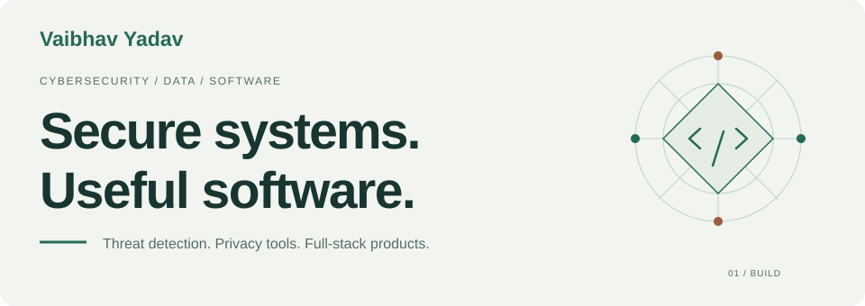
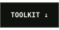
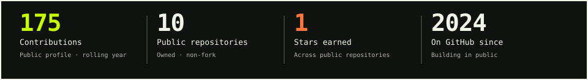
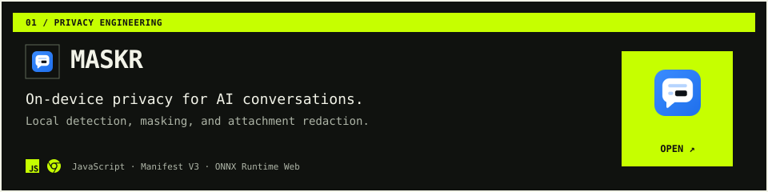
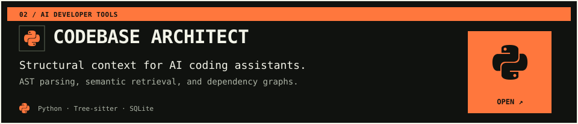
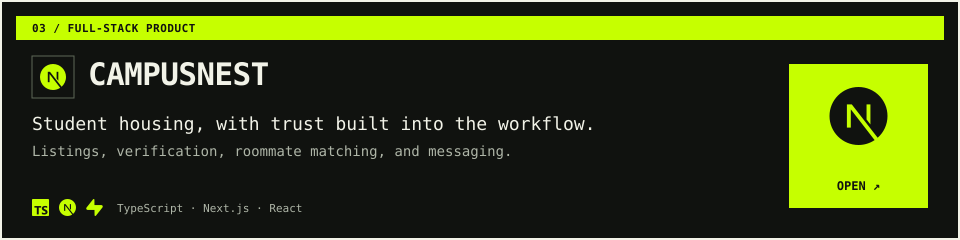
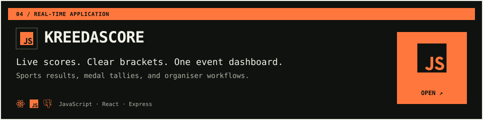
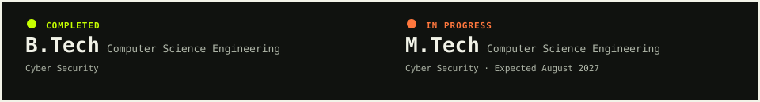
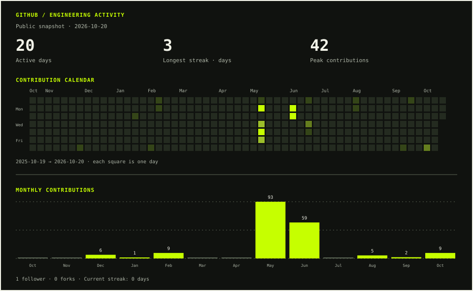

<!-- Generated from profile.json. Edit the source and rebuild. -->

<picture>
  <source media="(prefers-color-scheme: dark) and (max-width: 600px)" srcset="assets/hero-dark-mobile.svg">
  <source media="(max-width: 600px)" srcset="assets/hero-light-mobile.svg">
  <source media="(prefers-color-scheme: dark)" srcset="assets/hero-dark.svg">
  
</picture>

  
  
  
  
  

<h3 align="center">Data Analyst Intern @ Delhivery | Ex-SOC Intern @ RailTel
 
M.Tech Student | Developer of Maskr</h3>

I work at the intersection of cybersecurity, operational risk, and software engineering.
 
From SOC detection and logistics analytics to on-device privacy tools, I build systems that make complex work clearer and safer.

  
  
  
  

<picture>
  <source media="(prefers-color-scheme: dark) and (max-width: 600px)" srcset="assets/overview-dark-mobile.svg">
  <source media="(max-width: 600px)" srcset="assets/overview-light-mobile.svg">
  <source media="(prefers-color-scheme: dark)" srcset="assets/overview-dark.svg">
  
</picture>

## Current focus

| Focus | What I’m working on |
| :--- | :--- |
| **Role** | Data Analyst Intern at Delhivery · Risk analytics and operational insights |
| **Specialisation** | Cybersecurity, on-device privacy, and software engineering |
| **Building** | On-device privacy tools, structural context for AI assistants, and full-stack products |
| **Studying** | M.Tech in Computer Science Engineering, specialising in Cyber Security |

<strong>Past work & technical leadership</strong>

**SOC Intern · RailTel Corporation of India Limited**

May 2025 – July 2025 · Gurugram, India

- Worked with Elastic SIEM across 500K+ daily security events; tuned EQL/KQL detection rules to reduce false positives by 15%.
- Automated threat intelligence enrichment and supported incident response, SOC procedures, and MITRE ATT&CK-mapped reporting.

**Technical Lead · Parakram Sports Club, NFSU**

February 2026

Led technical operations for university sports events and built KreedaScore for score tracking, schedules, and live updates.

## Selected work

Four projects across privacy, developer infrastructure, and everyday workflows.

<a href="https://chromewebstore.google.com/detail/maskr-private-ai-leak-gua/adncldmdaamhlpcccigfhdipjhpicebe">
<picture>
  <source media="(prefers-color-scheme: dark) and (max-width: 600px)" srcset="assets/project-1-dark-mobile.svg">
  <source media="(max-width: 600px)" srcset="assets/project-1-light-mobile.svg">
  <source media="(prefers-color-scheme: dark)" srcset="assets/project-1-dark.svg">
  
</picture>
</a>

**Maskr**: An on-device privacy guard that checks prompts and attachments for sensitive data before they reach AI chatbots. Published on the Chrome Web Store.

  
  

 

<a href="https://github.com/ThomasShelby4477/CodeBase-Architect">
<picture>
  <source media="(prefers-color-scheme: dark) and (max-width: 600px)" srcset="assets/project-2-dark-mobile.svg">
  <source media="(max-width: 600px)" srcset="assets/project-2-light-mobile.svg">
  <source media="(prefers-color-scheme: dark)" srcset="assets/project-2-dark.svg">
  
</picture>
</a>

**Codebase Architect**: An MCP server that gives AI assistants structural context about a codebase through AST parsing, dependency graphs, and semantic search.

  
  

 

<a href="https://campusnest-two.vercel.app">
<picture>
  <source media="(prefers-color-scheme: dark) and (max-width: 600px)" srcset="assets/project-3-dark-mobile.svg">
  <source media="(max-width: 600px)" srcset="assets/project-3-light-mobile.svg">
  <source media="(prefers-color-scheme: dark)" srcset="assets/project-3-dark.svg">
  
</picture>
</a>

**CampusNest**: A student housing and roommate platform with listing discovery, verification workflows, compatibility matching, and real-time messaging.

  
  

 

<a href="https://kreedascore.vercel.app">
<picture>
  <source media="(prefers-color-scheme: dark) and (max-width: 600px)" srcset="assets/project-4-dark-mobile.svg">
  <source media="(max-width: 600px)" srcset="assets/project-4-light-mobile.svg">
  <source media="(prefers-color-scheme: dark)" srcset="assets/project-4-dark.svg">
  
</picture>
</a>

**KreedaScore**: A sports-event dashboard for scores, tournament brackets, and medal tallies, with dedicated organiser and admin workflows.

  
  

<strong>More projects & experiments</strong>

- [Satellite Telemetry](https://github.com/ThomasShelby4477/Satellite-Malware-Detection): Isolation Forest anomaly detection, Flask, and Streamlit monitoring.
- [SecureVault](https://github.com/ThomasShelby4477/securevault): Flask file management, encryption, and audit logging.
- [Chess Analyser Pro](https://github.com/ThomasShelby4477/Chess_Analyser_Pro): Computer vision for chess-piece classification and board reconstruction.
- [Auditorium Booking Portal](https://github.com/ThomasShelby4477/Real-time-Auditorium-Booking-Portal): Availability checks, booking requests, and admin approval.
- [Phone Detection](https://github.com/ThomasShelby4477/Phone_Detection) / [Presence-controlled Lighting](https://github.com/ThomasShelby4477/Turn_on_light): Computer vision and Arduino experiments.

## Toolkit

<picture>
  <source media="(prefers-color-scheme: dark) and (max-width: 600px)" srcset="assets/toolkit-dark-mobile.svg">
  <source media="(max-width: 600px)" srcset="assets/toolkit-light-mobile.svg">
  <source media="(prefers-color-scheme: dark)" srcset="assets/toolkit-dark.svg">
  
</picture>

<strong>Complete skills & technologies</strong>

| Area | Skills & technologies |
| :--- | :--- |
| **Security operations** | Elastic SIEM · EQL/KQL · Threat intelligence · Incident response · MITRE ATT&CK |
| **Application security** | API security · Burp Suite · OWASP ZAP · Nuclei · Nmap · Cryptography |
| **Languages** | Python · TypeScript · JavaScript · SQL |
| **Web & APIs** | React · Next.js · Node.js · Express · Flask |
| **Data & storage** | PostgreSQL · Supabase · SQLite · LanceDB |
| **AI & ML** | MCP · Tree-sitter · Local embeddings · scikit-learn · PyTorch |
| **Interfaces & tools** | Streamlit · Tailwind CSS · Git · Docker · Linux · Vercel |

## Education

**National Forensic Sciences University, Delhi**

<picture>
  <source media="(prefers-color-scheme: dark) and (max-width: 600px)" srcset="assets/education-dark-mobile.svg">
  <source media="(max-width: 600px)" srcset="assets/education-light-mobile.svg">
  <source media="(prefers-color-scheme: dark)" srcset="assets/education-dark.svg">
  
</picture>

**B.Tech completed · M.Tech in progress**: Computer Science Engineering, Cyber Security specialisation.

Working toward Certified Ethical Hacker (EC-Council).

## GitHub activity

<picture>
  <source media="(prefers-color-scheme: dark) and (max-width: 600px)" srcset="assets/activity-dark-mobile.svg">
  <source media="(max-width: 600px)" srcset="assets/activity-light-mobile.svg">
  <source media="(prefers-color-scheme: dark)" srcset="assets/activity-dark.svg">
  
</picture>

Public profile snapshot. Contributions follow GitHub’s rolling year; monthly bars cover the displayed calendar, with partial first and last months. Repository metrics cover public, owned, non-fork repos. Streaks count consecutive active calendar days.

  
  

## Connect

Let’s connect about cybersecurity, privacy engineering, AI developer tools, or useful software.

  
  
  
  

[vaibhavya08@gmail.com](mailto:vaibhavya08@gmail.com) &nbsp; · &nbsp; [LinkedIn](https://www.linkedin.com/in/vaibhav082004/)

---

Thoughtful engineering, from data to interface.
